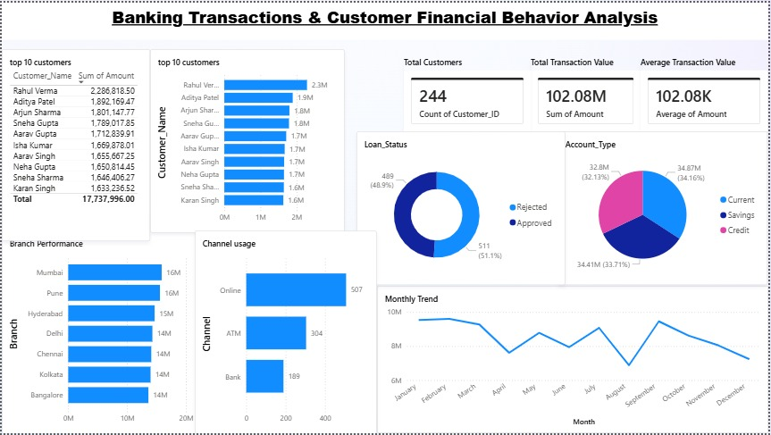

# Banking Transactions Financial Behaviour

## 👩‍💻 About Me

**Shrishti Rana**
**Data Analyst**

---

## 📊 Project Overview

This project analyzes financial transaction data to understand customer behaviour, transaction patterns, branch performance, transaction channels, loan status, and monthly transaction trends.

The project uses **Python, Excel, MySQL, and Power BI** to perform data cleaning, exploratory data analysis, SQL-based analysis, and interactive data visualization.

---

## 🎯 Objectives

* Analyze financial transaction patterns
* Understand customer transaction behaviour
* Identify high-value customers
* Analyze branch-wise transaction performance
* Analyze transaction channel usage
* Study loan status distribution
* Analyze monthly transaction trends
* Build an interactive Power BI dashboard

---

## 📁 Project Structure

```text
banking-transactions-financial-behaviour/
│
├── data/
│   ├── finance_transactions_1000_records.csv
│   └── finance_transactions_1000_records.xlsx
│
├── notebook/
│   └── finance_data_analysis.ipynb
│
├── power_bi/
│   ├── dashboard_overview.jpeg
│   └── finance_dashboard.pbix
│
├── sql/
│   ├── finance_analysis_queries.sql
│   └── finance_analysis_queries.pdf
│
└── README.md
```

---

## 📌 Dataset

The dataset contains **1,000 financial transaction records** and includes the following fields:

* Transaction_ID
* Date
* Customer_ID
* Customer_Name
* Account_Type
* Transaction_Type
* Amount
* Branch
* Channel
* Loan_Status
* Credit_Score

---

## 🛠️ Tools & Technologies

| Tool       | Purpose                                |
| ---------- | -------------------------------------- |
| Python     | Data cleaning and exploratory analysis |
| Pandas     | Data manipulation                      |
| Matplotlib | Data visualization                     |
| Excel      | Pivot tables and charts                |
| MySQL      | SQL-based data analysis                |
| Power BI   | Interactive dashboard                  |

---

## 🔍 Analysis Performed

### Python

The dataset was loaded and analyzed using Pandas. Data preparation included checking data quality, handling data types, and creating additional fields such as Month for trend analysis.

The analysis includes:

* Transaction summary
* Customer analysis
* High-value customer identification
* Branch performance
* Channel usage
* Loan status analysis
* Monthly transaction trends

### Excel

Excel was used for:

* Pivot tables
* Summary analysis
* Branch-wise analysis
* Channel usage analysis
* Loan status analysis
* Monthly trend analysis
* Data visualization

### SQL

MySQL was used to perform analytical queries including:

* Total number of transactions
* Total transaction value
* Average transaction value
* Top 10 customers
* Branch-wise performance
* Channel usage
* Loan status distribution
* Monthly transaction trends

### Power BI

An interactive dashboard was created to visualize:

* Total Customers
* Total Transaction Value
* Average Transaction Value
* Top 10 Customers
* Loan Status
* Account Type
* Branch Performance
* Channel Usage
* Monthly Transaction Trend

---

## 📊 Power BI Dashboard

### Dashboard Preview



The Power BI `.pbix` file is available in the `power_bi` folder.

---

## 💡 Key Business Insights

The analysis provides insights into:

- **Total Transaction Value:** 102.08M
- **Account Type Analysis:** CUrrent accounts represent the highest transaction value.
- **Best Branch Performance:** Mumbai has the highest transaction value among the branches.
- **Loan Status:** 48.9% of transactions are approved, while 51.1% are rejected.
- **Most Used Channel:** Online is the most frequently used transaction channel.
- **High-Value Customers:** The dashboard identifies the Top 10 customers based on total transaction value.
- **Monthly Transaction Trend:** Transaction values fluctuate across the months, highlighting changes in customer transaction activity.

---

## 📈 Project Outcome

The project demonstrates an end-to-end data analytics workflow:

**Raw Data → Data Cleaning → Exploratory Analysis → SQL Analysis → Excel Analysis → Power BI Dashboard**

It provides a practical example of using multiple data analytics tools to transform transaction data into meaningful business insights.

---

## 👩‍💻 Skills Demonstrated

* Data Cleaning
* Exploratory Data Analysis
* Python / Pandas
* SQL
* Excel Pivot Tables
* Data Visualization
* Power BI
* Business Analysis
* Dashboard Development

---

## 📂 Files Included

* `data/` — Dataset
* `notebooks/` — Python analysis notebook
* `sql/` — SQL queries and PDF documentation
* `power-bi/` — Power BI dashboard and preview image

---

## 📌 Note

This project is created for educational and portfolio purposes.

